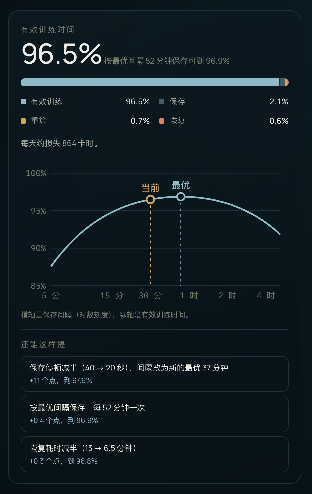

<div align="center">

# Ckpt Goodput

**千卡训练的 checkpoint 间隔计算器 · 存得勤一点，还是存得少一点？**

填入卡数、故障率、保存停顿和恢复耗时，算出最划算的 checkpoint 间隔，并把墙钟时间拆成有效训练、保存、重算和恢复四份。

[**在线使用**](https://ai-loren.github.io/personal-homepage/#projects/ckpt-goodput) · [一个例子](#一个例子) · [怎么算的](#怎么算的) · [API](#api) · [English](#english)

[](LICENSE)   


</div>

## 为什么需要它

千卡训练里中断躲不掉。checkpoint 存得勤，每次保存都要停一下；存得少，坏一次就要把上次保存之后的进度重算一遍。两头之间有一个最划算的间隔。

这个间隔常被凭感觉定成「每小时一次」或者「每 2 小时一次」。可它其实只取决于两件事：存一次要停多久，整个集群多久坏一次。卡数一翻倍，集群坏得就勤一倍，原来合适的间隔可能就不合适了。

## 能做什么

- **四份时间**：墙钟时间拆成有效训练、保存、重算、恢复，四份加起来正好 100%，一眼看出时间花在了哪。
- **最优间隔**：给出精确的最优保存间隔和对应的有效训练时间，并画出有效训练时间随保存间隔变化的曲线，标出「当前」和「最优」两个点。
- **按规模换算**：单卡平均故障间隔除以卡数，就是集群多久中断一次；卡数一变，所有结果跟着变。
- **改法建议**：分别试「保存停顿减半并改用新的最优间隔」「恢复耗时减半」「改用最优间隔」三种改法，按能提多少排序，点一下就换上。
- **配置检查**：卡数不是整数、停顿填 0 这类输入会被拦下，并告诉你该填什么。
- **零依赖**：一个 JS 文件，纯前端运行，不联网，计算部分是纯函数。

## 一个例子



1024 张卡，单卡平均故障间隔 3.5 万小时，也就是集群每 34 小时 11 分中断一次。每 2 小时同步保存一次，每次停 9 分钟；出了故障，从发现到重新跑起来要 55 分钟：

| | 占墙钟时间 |
| --- | ---: |
| 有效训练 | **87.7%** |
| 保存 | 6.6% |
| 重算 | 3.0% |
| 恢复 | 2.6% |

每天约损失 3,012 卡时。最优间隔是 3 小时 6 分，比现在的 2 小时还长：每次停 9 分钟时，存得越勤越亏。它给出的改法：

1. 保存停顿减半，间隔改为新的最优 2 小时 13 分：+3.3 个点，到 91.0%
2. 恢复耗时减半：+1.2 个点，到 88.9%
3. 按最优间隔保存：+0.8 个点，到 88.5%

换成异步保存（每 30 分钟一次，只停 40 秒）、自动发现故障并用热备节点续训（13 分钟恢复），有效训练时间升到 **96.5%**，每天只损失 864 卡时。

**规模放大以后**：单卡故障率不变，换成 16,384 张卡，集群每 2 小时 8 分就中断一次。原来的配置只剩 **35.1%**，改进后的配置还有 78.2%。所以规模越大，保存停顿和恢复速度越值钱。

<br clear="right">

## 快速开始

**在线**：打开 [ai-loren.github.io/personal-homepage/#projects/ckpt-goodput](https://ai-loren.github.io/personal-homepage/#projects/ckpt-goodput)，改配置，结果立刻更新。

**在自己的页面里用**：引入脚本后，工具注册在 `window.SITE_TOOLS['ckpt-goodput']` 上。

```html
<script src="ckpt-goodput.js"></script>
<script>
  const ckpt = window.SITE_TOOLS['ckpt-goodput'];
  const result = ckpt.estimate({
    gpus: 1024,
    mtbfHours: 35000,     // 单卡平均故障间隔，小时
    intervalMinutes: 120, // 保存间隔
    saveSeconds: 540,     // 每次保存让训练停下多久
    restartMinutes: 55,   // 从出故障到训练重新跑起来
  });

  console.log(result.current.goodput.toFixed(3)); // 0.877
  console.log(ckpt.duration(result.optimal));     // 3 小时 6 分
</script>
```

想要现成的界面，就调 `ckpt.mount(element)`。它会渲染完整的表单、结果面板和曲线，结构上带 `ckpt-*` 类名，样式由你的页面提供。

## 怎么算的

符号：$N$ 卡数，$m$ 单卡平均故障间隔，$M = m / N$ 集群平均中断间隔，$\tau$ 保存间隔，$\delta$ 每次保存的停顿，$R$ 从出故障到重新跑起来的耗时。

### 有效训练时间

故障按泊松过程到达，保存和恢复的途中也可能中断。按 Daly（2006）的完整模型（Eq. 20），真正推进训练的时间占墙钟时间的比例是：

```math
G(\tau) = \frac{\tau}{M\, e^{R/M} \left(e^{(\tau+\delta)/M} - 1\right)}
```

故障再频繁，它也只会趋近 0，不会算出负数。

### 四份怎么拆

记 $x = (\tau + \delta)/M$，恢复以外的时间占 $e^{-R/M}$：

| 份 | 占墙钟时间 | 故障远比间隔稀疏时 |
| --- | --- | --- |
| 恢复 | $1 - e^{-R/M}$ | $R/M$ |
| 有效训练 | $e^{-R/M} \cdot \frac{x}{e^x - 1} \cdot \frac{\tau}{\tau + \delta}$ | $1 - \frac{\delta}{\tau} - \frac{\tau+\delta}{2M} - \frac{R}{M}$ |
| 保存 | $e^{-R/M} \cdot \frac{x}{e^x - 1} \cdot \frac{\delta}{\tau + \delta}$ | $\delta / \tau$ |
| 重算 | $e^{-R/M} \left(1 - \frac{x}{e^x - 1}\right)$ | $(\tau + \delta) / 2M$ |

四份加起来恰好是 1；右列就是常见的一阶近似。

### 最优间隔

对 $G(\tau)$ 求极值得到 Daly 的 Eq. 21，它在 $(0, M)$ 内恰好有一个根，工具用二分法求精确解：

```math
\left(1 - \frac{\tau}{M}\right) e^{(\tau+\delta)/M} = 1
```

- 最优间隔只取决于 $\delta$ 和 $M$，和恢复耗时 $R$ 无关；$R$ 只决定能达到多高。
- 它比 Young（1974）的一阶近似 $\sqrt{2\delta M}$ 略短：上面的例子里，精确解是 3 小时 6 分，一阶近似是 3 小时 12 分。

## 适用范围

这是按模型推算的结果，不是实测。以下几项没有算进去：

- checkpoint 写入失败、慢节点拖慢整体速度
- 计划内维护、数据加载卡顿
- 只重启单个节点的弹性训练：这里假设每次故障都整体回退到上一个 checkpoint
- 故障率随时间变化（新硬件早期故障偏多、老化后增多）：这里按恒定的故障率算

## API

| 导出 | 说明 |
| --- | --- |
| `estimate(config)` | 返回 `{ clusterMtbf, failuresPerDay, optimal, current, best, lostGpuHoursPerDay }`；配置不成立时只返回 `{ error }` |
| `suggestions(config)` | 最多三种改法，按提升排序，每项是 `{ label, change, goodput, gain }` |
| `breakdown(τ, δ, R, M)` | 四份时间 `{ goodput, save, rework, restart }`，参数单位都是小时 |
| `optimalInterval(δ, M)` | 最优保存间隔，小时 |
| `duration(hours)` | 把小时数格式化成「3 小时 6 分」「52 分钟」「40 秒」 |
| `mount(element)` | 在元素里渲染完整的表单、结果面板和曲线 |
| `DEFAULTS` | 表单默认值 |

**`config`**

| 字段 | 含义 |
| --- | --- |
| `gpus` | 卡数，正整数 |
| `mtbfHours` | 单卡平均故障间隔，小时 |
| `intervalMinutes` | 保存间隔，分钟 |
| `saveSeconds` | 每次保存让训练停下多久，秒；异步保存只填真正阻塞的那一段 |
| `restartMinutes` | 从出故障到训练重新跑起来，分钟，可以是 0 |

**返回值**

| 字段 | 含义 |
| --- | --- |
| `clusterMtbf` / `failuresPerDay` | 集群平均中断间隔（小时）/ 每天中断次数 |
| `optimal` | 最优保存间隔，小时 |
| `current` / `best` | 当前间隔 / 最优间隔下的四份时间 |
| `lostGpuHoursPerDay` | 每天损失的卡时 |

## 测试

```bash
node --test
```

需要 Node 18 以上，不用安装依赖。期望值都用独立实现算好后写成字面数字，覆盖这些内容：

- 四份时间的精确值，以及加起来等于 1
- 故障稀疏时退化为一阶近似
- 最优间隔满足 Daly Eq. 21、与他的 Eq. 37 近似一致、优于其他任何间隔，并且与恢复耗时无关
- 卡数与集群中断间隔的反比关系
- 时长的中文格式化
- 非法输入的错误信息
- 改法建议的排序与效果，以及「帮不上忙的改法不出现」

## 参考

- Young. [A First Order Approximation to the Optimum Checkpoint Interval](https://dl.acm.org/doi/10.1145/361147.361115). Communications of the ACM, 1974.
- Daly. [A Higher Order Estimate of the Optimum Checkpoint Interval for Restart Dumps](https://doi.org/10.1016/j.future.2004.11.016). Future Generation Computer Systems, 2006.
- Llama Team, AI @ Meta. [The Llama 3 Herd of Models](https://ai.meta.com/research/publications/the-llama-3-herd-of-models/). 2024. 16,384 张卡、54 天预训练里有 419 次意外中断，折算单卡平均故障间隔约 5.1 万小时。

## English

Ckpt Goodput answers a question every large training run faces: how often should you checkpoint? Save too often and every save stalls training; save too rarely and each failure throws away everything since the last save.

- Splits wall-clock time into **goodput, checkpointing, rework and restart**, using Daly's exact model for Poisson failures (failures may also hit saves and restarts). The four shares always add up to 100%.
- Solves Daly's optimality condition exactly for the **best checkpoint interval**, and plots goodput against the interval with the current and optimal points marked.
- Scales failures with cluster size (cluster MTBF = per-GPU MTBF / GPUs), and ranks three levers: halve the save pause, halve the restart time, or move to the optimal interval.
- A single dependency-free JavaScript file. Try it [online](https://ai-loren.github.io/personal-homepage/#projects/ckpt-goodput), or call `window.SITE_TOOLS['ckpt-goodput'].estimate(config)`; the formulas and API are documented above.

## License

[MIT](LICENSE)
